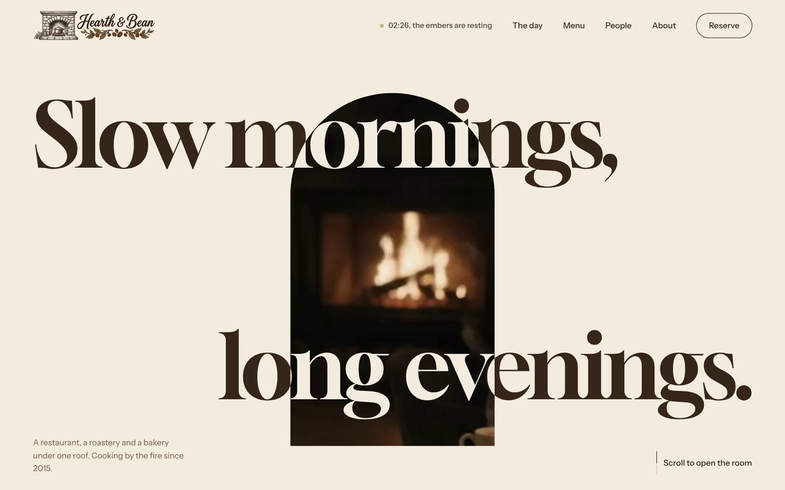
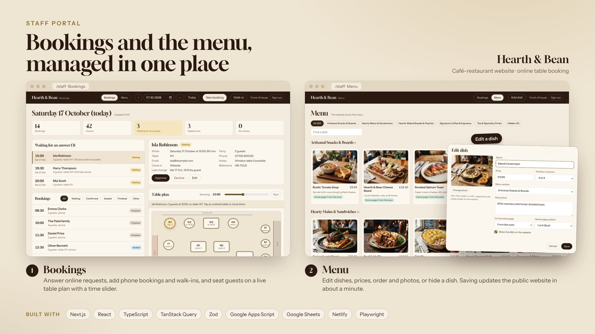
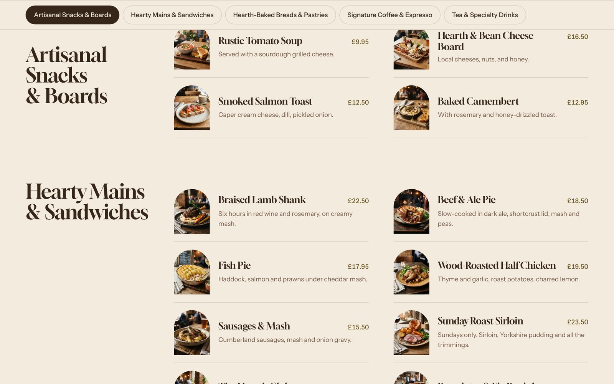

# Hearth & Bean

A café-restaurant website with online table booking and a staff portal for managing bookings and the menu.

**Live site:** [hearth-and-bean-bath.netlify.app](https://hearth-and-bean-bath.netlify.app)



## Features

### Table booking (guests)

- Guests choose the party size, date and seating area (window, fireside, room or bar).
- Only times with a free table for that party are offered, based on opening hours, table sizes and existing bookings.
- A request is saved as **pending** with a reference number. The guest gets a confirmation email and the restaurant
  gets a notification with a link to the staff portal.
- Built-in spam protection: a hidden honeypot field, an hourly request limit and a duplicate-booking check.

### Staff portal: bookings (`/staff`)

- Staff sign in with their own name and password.
- **Requests:** new online requests can be confirmed or declined, and the guest is emailed automatically.
- **Day view:** every booking of the day with a summary of bookings and covers. Staff can add phone bookings and
  walk-ins, edit details, and mark guests as seated, finished or no-show.
- **Table plan:** an interactive floor plan with a time slider. It shows which tables are taken at any moment, and a
  booking can be moved to another table.
- The system picks a suitable table for every booking and refuses any change that would double-book a table.



### Staff portal: menu editor

- Lists every dish with its photo, price and section, with search and section filters.
- Staff can add a dish, edit its name, description and price, or hide it from the website without deleting it.
- Dish photos are uploaded straight from the browser. Large images are resized before upload.
- Staff choose a dish's position in its menu section and whether it appears on the home page.
- Saving publishes the change: the website rebuilds itself with the new menu, without a developer.

### Website

- A scroll-driven home page with a canvas "film" and GSAP animations, a full menu with sticky section tabs, and an
  about page.
- Accessible: everything works with the keyboard, pop-ups follow ARIA patterns, and visitors who prefer reduced motion
  get a still page.



## Architecture

```
Next.js site (Netlify)  ──POST requests──►  Google Apps Script web app  ──►  Google Sheets (all data)
                                                                       └─►  Google Drive (dish photos)
                                                                       └─►  Gmail (booking emails)
Staff saves the menu  ──►  Netlify build hook  ──►  site rebuilt with the latest menu
```

### Frontend

The website is built with Next.js and exported as static pages, so it loads fast and needs no server of its own. The
booking form and the staff portal talk to the backend through one typed API client (`src/lib/booking-api.ts`). It uses
TanStack Query for loading and saving data, and every response is validated with Zod before it reaches the UI.

### Backend: Google Apps Script

The backend is a Google Apps Script web app (`google-apps-script/`) published at a single URL. The site sends it JSON
requests, and the script reads and writes the Google Sheet, stores photos in Google Drive and sends emails. All
booking rules are enforced here, under a lock, so two people can never take the same table at the same time.

| Request                                   | Used by       | What it does                                                    |
| ----------------------------------------- | ------------- | --------------------------------------------------------------- |
| `config`                                  | Booking form  | Opening hours, seating areas, party size limits                 |
| `availability`                            | Booking form  | Free times for a date and party size                            |
| `book`                                    | Booking form  | Saves a request, picks a table, emails the guest and restaurant |
| `login`                                   | Staff portal  | Checks the password and returns a signed token (valid 12 hours) |
| `day`                                     | Staff portal  | Bookings, requests and tables for one day                       |
| `setStatus`, `assign`, `create`, `update` | Staff portal  | Confirm or decline, move tables, add and edit bookings          |
| `menuAdmin`, `menuSave`, `menuUpload`     | Menu editor   | List, save and add photos to dishes                             |
| `menuPublish`                             | Menu editor   | Triggers a Netlify rebuild so the menu goes live                |
| `menu`, `menuPhoto`                       | Netlify build | Downloads the menu and photos into the site                     |

Every staff request carries the signed token and is checked on the server. Request fields, responses and error
codes are documented in [docs/API.md](docs/API.md).

### Data: Google Sheets and Drive

The Google Sheet works as the database, so the restaurant can also view and edit everything in a familiar
spreadsheet.

| Tab      | Holds                                                                     |
| -------- | ------------------------------------------------------------------------- |
| Bookings | Every booking: guest details, date, time, table, status, who changed it   |
| Tables   | Table sizes, seating areas and positions on the floor plan                |
| Hours    | Opening hours for each day of the week                                    |
| Settings | Restaurant email, booking rules (slot length, notice, party size, emails) |
| Staff    | Staff names and passwords                                                 |
| Menu     | Dishes: name, description, price, section, position, photo, visibility    |

Dish photos are stored in a Google Drive folder and copied into the site when it is built.

## Tech stack

| Area       | Technology                                                            |
| ---------- | --------------------------------------------------------------------- |
| Frontend   | Next.js 16 (App Router, static export), React 19, TypeScript (strict) |
| Data       | TanStack Query, native `fetch`                                        |
| Validation | Zod for every API response and form                                   |
| Animation  | GSAP with ScrollTrigger, Draggable and Inertia                        |
| Backend    | Google Apps Script, Google Sheets, Google Drive, Gmail                |
| Hosting    | Netlify, deployed from GitHub, with a build hook for menu updates     |
| Tooling    | ESLint, Prettier                                                      |

## Project structure

```
src/
  app/              routes: /, /menu, /about, /staff, 404, sitemap, robots
  components/       page sections (home, menu, about) and shared header and footer
  features/
    booking/        booking form
    staff/          staff portal: sign-in, day view, table plan, booking dialog, menu editor
    home/, menu/    scroll animations and menu tabs
  lib/              API client with Zod schemas, date helpers
  data/             menu data and the snapshot used for local work
  styles/           design system CSS and self-hosted fonts
scripts/            build step that syncs the menu from the Sheet
google-apps-script/ backend (Code.gs, Menu.gs, MenuAdmin.gs) and a local test server
public/             images, film frames, fonts
```

## Running locally

Requires Node.js 20.9 or newer.

```bash
npm install
npm run mock-api   # local backend on :8792 (sign-in: staff / local-test-pass)
npm run dev        # http://localhost:3000
```

Set `NEXT_PUBLIC_BOOKING_API_URL` in `.env.local` (see `.env.example`). Left empty, the booking form runs in preview
mode and the committed menu snapshot is used. Other scripts: `npm run build`, `npm run lint`, `npm run typecheck`.

## Author

Built by **Victor Tar** · [LinkedIn](https://www.linkedin.com/in/viktor-tar/) ·
[GitHub](https://github.com/viktor-tar). Developed with AI-assisted tooling (Claude Code).
